# Types of Charts Used in Data Analysis Using Python

This guide covers 22 commonly used charts for exploratory data analysis (EDA), statistical analysis, and business reporting. The included chart images use illustrative synthetic data.

## Python visualization libraries

- **Matplotlib:** flexible foundation for static charts and customization.
- **Seaborn:** statistical visualizations with convenient DataFrame support.
- **Plotly:** interactive charts, hover details, and dashboards.
- **Pandas:** quick charts directly from Series and DataFrames, usually powered by Matplotlib.

## Setup

```bash
pip install pandas numpy matplotlib seaborn plotly
```

```python
import pandas as pd
import numpy as np
import matplotlib.pyplot as plt
import seaborn as sns
```

## Chart selection guide

| Analysis goal | Useful charts |
|---|---|
| Compare categories | Bar, horizontal bar, grouped bar, stacked bar |
| Understand trends over time | Line, area, stacked area |
| Understand distributions | Histogram, box, violin, KDE |
| Explore relationships | Scatter, bubble, heatmap, pair plot |
| Show composition | Pie, donut, treemap, stacked bar |
| Explain stages or changes | Funnel, waterfall |
| Compare multi-metric profiles | Radar |
| Show uncertainty | Error bar |

## Comparison charts

### 1. Bar Chart

Compares values across categories, such as units sold by product.

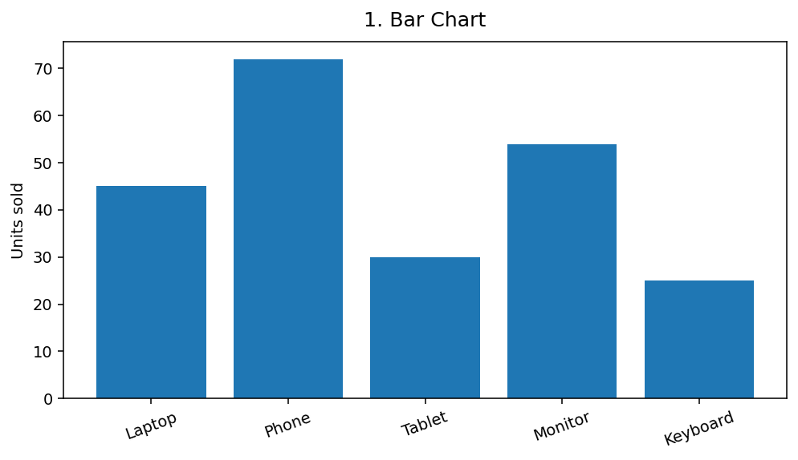

- Matplotlib: `plt.bar()`
- Seaborn: `sns.barplot()`

**Example:**

```python
products = ["Laptop", "Phone", "Tablet"]
sales = [45, 72, 30]
plt.bar(products, sales)
plt.title("Sales by Product")
plt.xlabel("Product")
plt.ylabel("Units Sold")
plt.show()
```

### 2. Horizontal Bar Chart

Compares categories with long labels, such as revenue by product name.

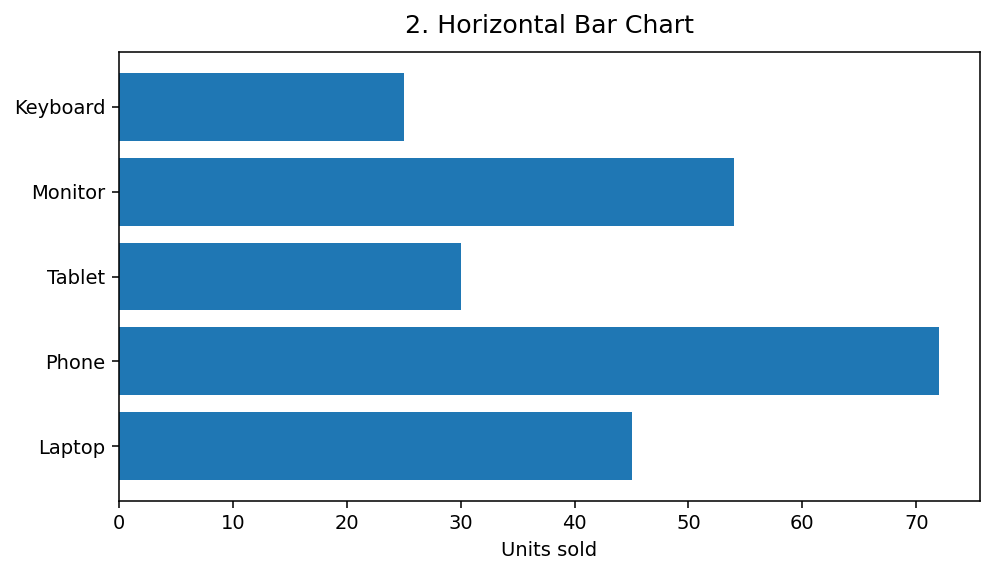

- Matplotlib: `plt.barh()`
- Seaborn: `sns.barplot()`

### 3. Grouped Bar Chart

Compares multiple series side by side, such as sales by product across years.

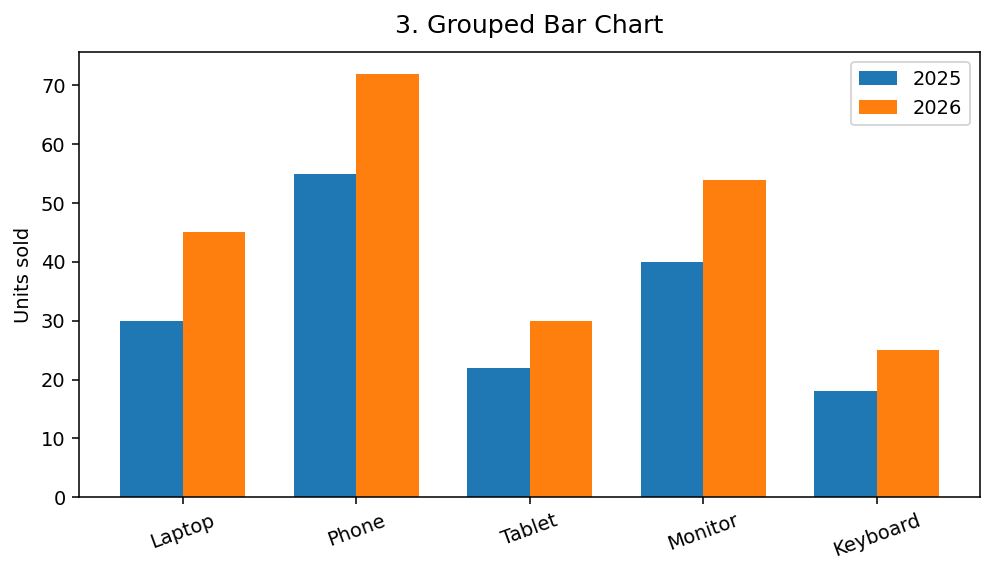

- Matplotlib: `plt.bar()`
- Seaborn: `sns.barplot()`

### 4. Stacked Bar Chart

Shows how category components add up to a total.

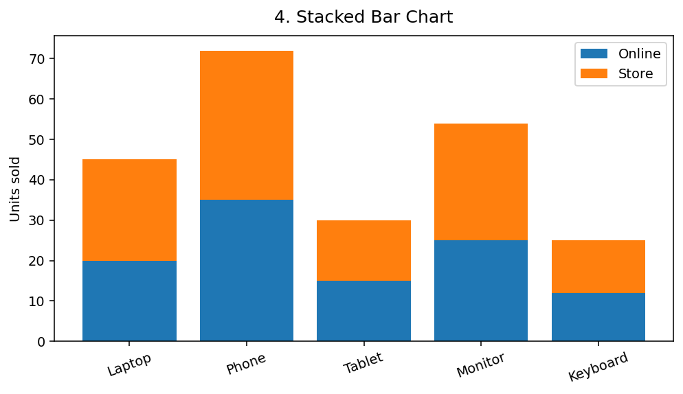

- Matplotlib: `plt.bar()`
- Seaborn: `Custom plotting`

## Trend analysis charts

### 5. Line Chart

Shows changes and trends over an ordered sequence, especially time.

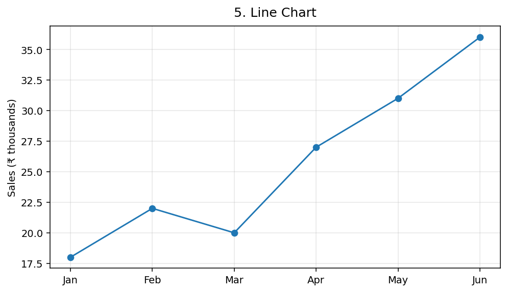

- Matplotlib: `plt.plot()`
- Seaborn: `sns.lineplot()`

**Example:**

```python
months = ["Jan", "Feb", "Mar", "Apr"]
sales = [18, 22, 20, 27]
plt.plot(months, sales, marker="o")
plt.title("Monthly Sales")
plt.xlabel("Month")
plt.ylabel("Sales")
plt.grid(True)
plt.show()
```

### 6. Area Chart

Shows trend and magnitude with the area under a line filled.

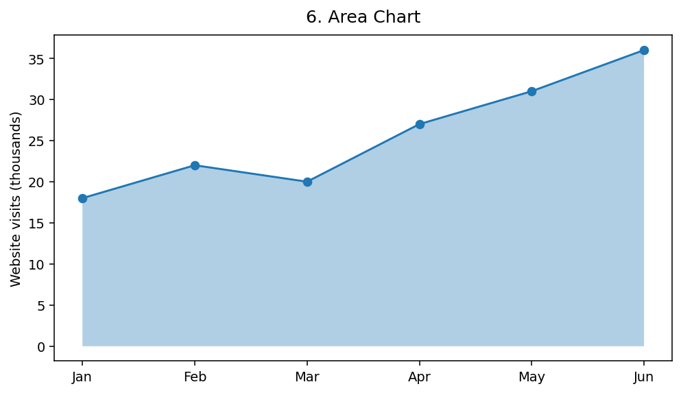

- Matplotlib: `plt.fill_between()`
- Seaborn: `Custom plotting`

### 7. Stacked Area Chart

Shows how multiple series contribute to a changing total over time.

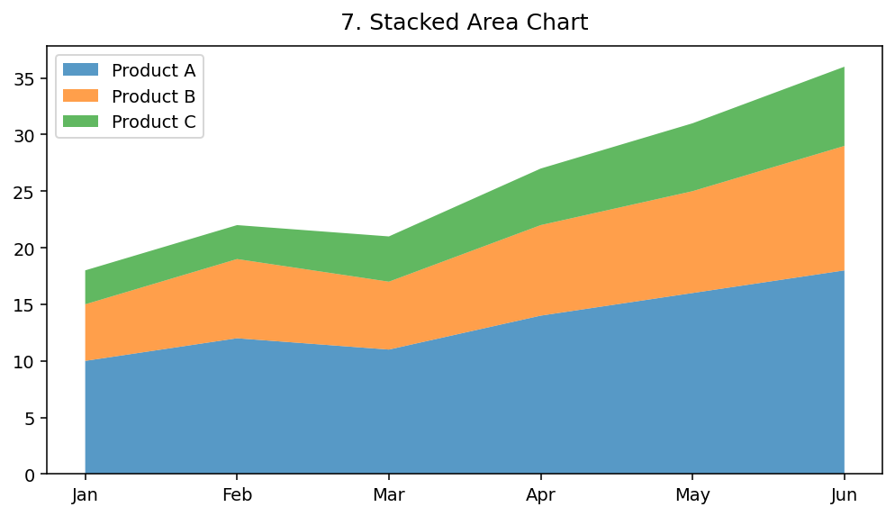

- Matplotlib: `plt.stackplot()`
- Seaborn: `Custom plotting`

## Distribution charts

### 8. Histogram

Shows the frequency distribution of a numerical variable.

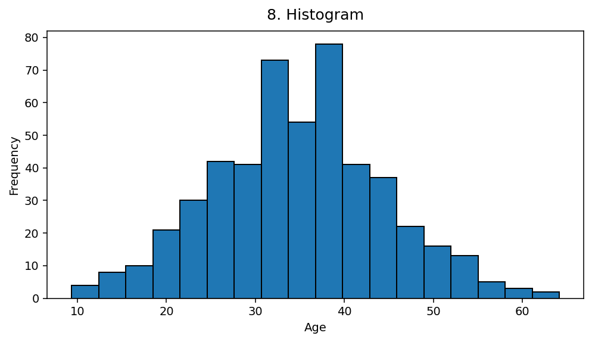

- Matplotlib: `plt.hist()`
- Seaborn: `sns.histplot()`

**Example:**

```python
ages = [21, 24, 22, 25, 29, 31, 24, 27, 35, 40]
plt.hist(ages, bins=5, edgecolor="black")
plt.xlabel("Age")
plt.ylabel("Frequency")
plt.title("Age Distribution")
plt.show()
```

### 9. Box Plot

Summarizes median, quartiles, spread and potential outliers.

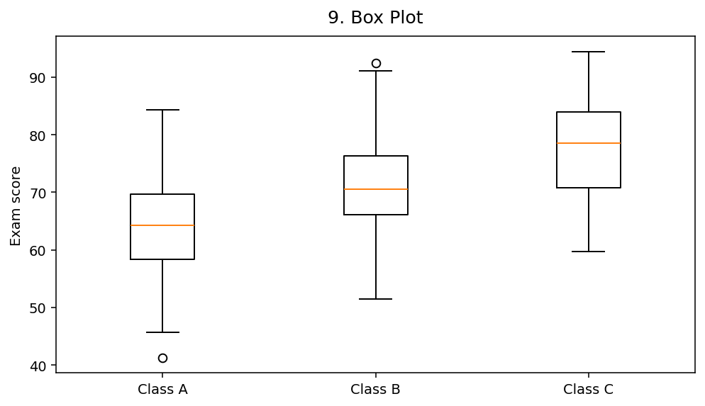

- Matplotlib: `plt.boxplot()`
- Seaborn: `sns.boxplot()`

### 10. Violin Plot

Shows distribution shape and density for one or more groups.

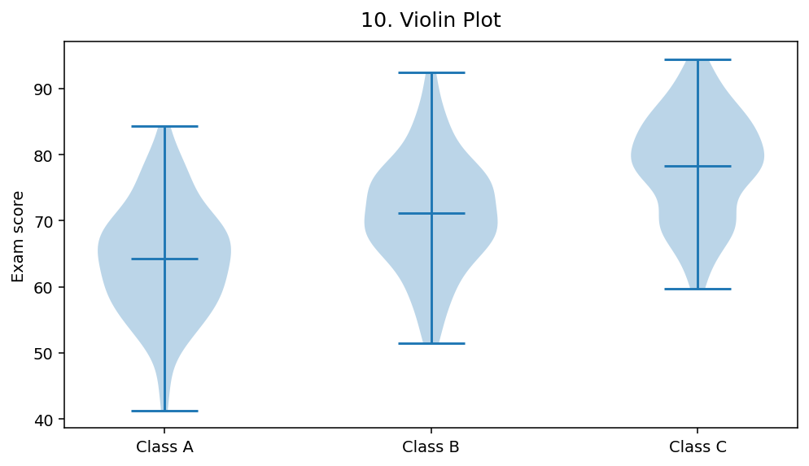

- Matplotlib: `plt.violinplot()`
- Seaborn: `sns.violinplot()`

### 11. KDE Plot

Shows a smoothed estimate of a variable's probability density.

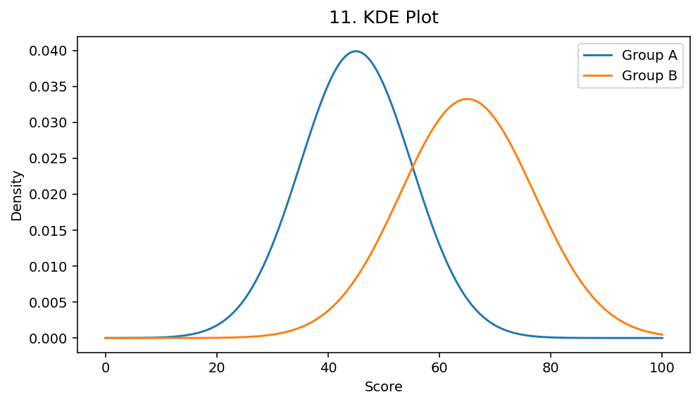

- Matplotlib: `Density plotting`
- Seaborn: `sns.kdeplot()`

## Relationship and correlation charts

### 12. Scatter Plot

Shows the relationship between two numerical variables.

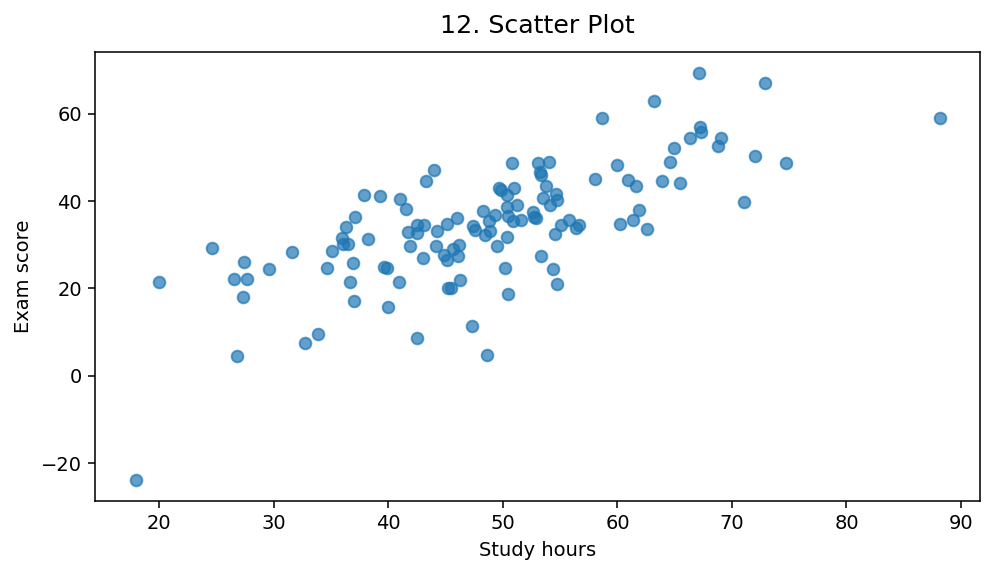

- Matplotlib: `plt.scatter()`
- Seaborn: `sns.scatterplot()`

**Example:**

```python
study_hours = [1, 2, 3, 4, 5, 6]
scores = [45, 50, 58, 65, 72, 85]
plt.scatter(study_hours, scores)
plt.xlabel("Study Hours")
plt.ylabel("Exam Score")
plt.title("Study Hours vs Exam Score")
plt.show()
```

### 13. Bubble Chart

Scatter plot where marker size represents a third numerical variable.

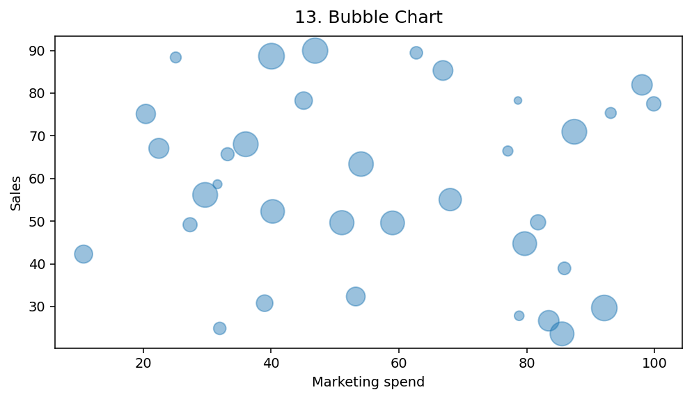

- Matplotlib: `plt.scatter(s=...)`
- Seaborn: `sns.scatterplot(size=...)`

### 14. Heatmap

Uses color to show values in a matrix, often a correlation matrix.

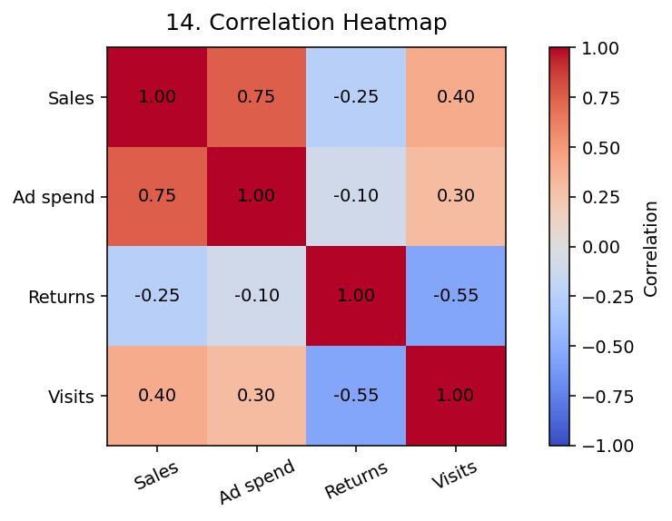

- Matplotlib: `plt.imshow()`
- Seaborn: `sns.heatmap()`

**Example:**

```python
numeric_data = df.select_dtypes(include="number")
correlation = numeric_data.corr()
sns.heatmap(correlation, annot=True, cmap="coolwarm")
plt.title("Correlation Heatmap")
plt.show()
```

### 15. Pair Plot

Shows pairwise relationships among several numerical variables.

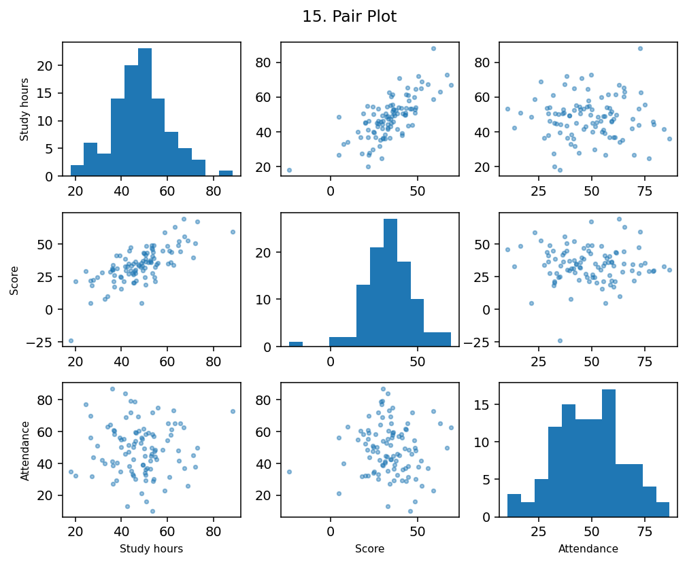

- Matplotlib: `No single built-in function`
- Seaborn: `sns.pairplot()`

## Composition charts

### 16. Pie Chart

Shows parts of a whole; best for a small number of categories.

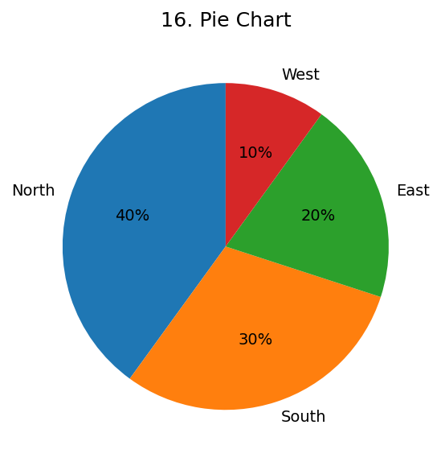

- Matplotlib: `plt.pie()`
- Seaborn: `No standard direct function`

### 17. Donut Chart

A pie chart with a central hole; shows proportions.

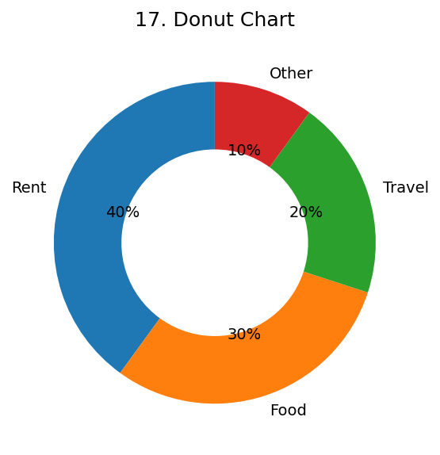

- Matplotlib: `plt.pie(wedgeprops=...)`
- Seaborn: `Custom plotting`

### 18. Treemap

Shows hierarchical parts of a whole using nested rectangles.

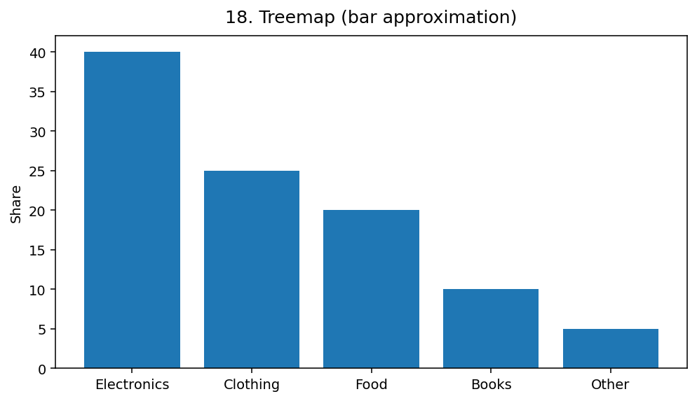

- Matplotlib: `No standard built-in function`
- Seaborn: `No standard built-in function`

## Specialized charts

### 19. Waterfall Chart

Shows how sequential positive and negative changes lead to a final value.

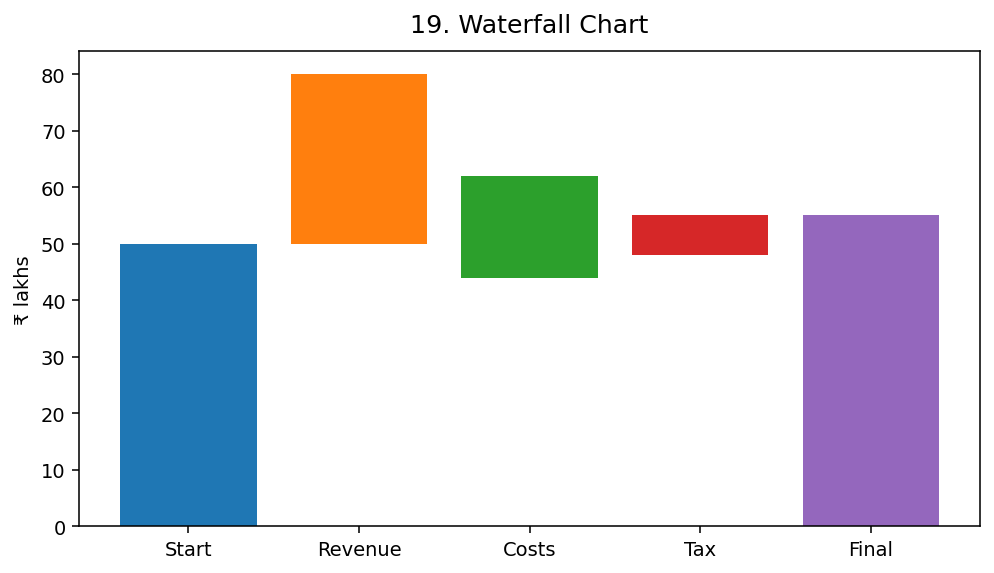

- Matplotlib: `Custom bar plotting`
- Seaborn: `Custom plotting`

### 20. Funnel Chart

Shows values across sequential stages, such as a sales pipeline.

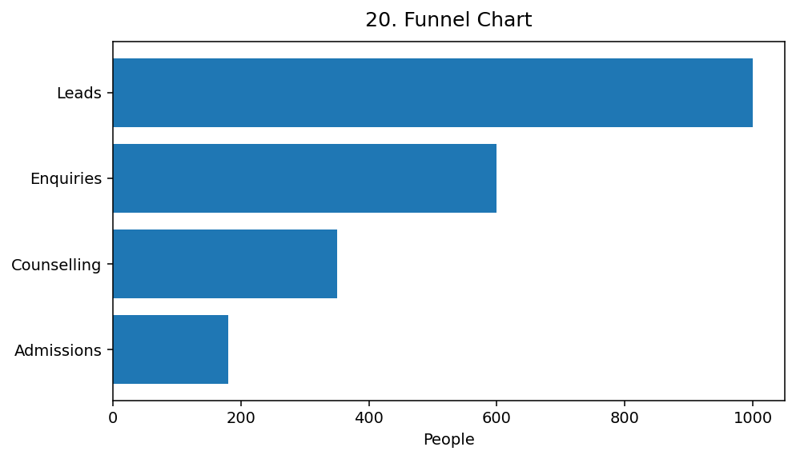

- Matplotlib: `Custom bar plotting`
- Seaborn: `Custom plotting`

### 21. Radar Chart

Compares several metrics for one or more subjects on radial axes.

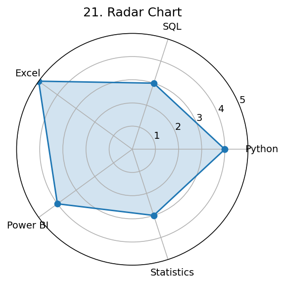

- Matplotlib: `Polar axes`
- Seaborn: `Custom plotting`

### 22. Error Bar Chart

Shows uncertainty or variability around a measured value.

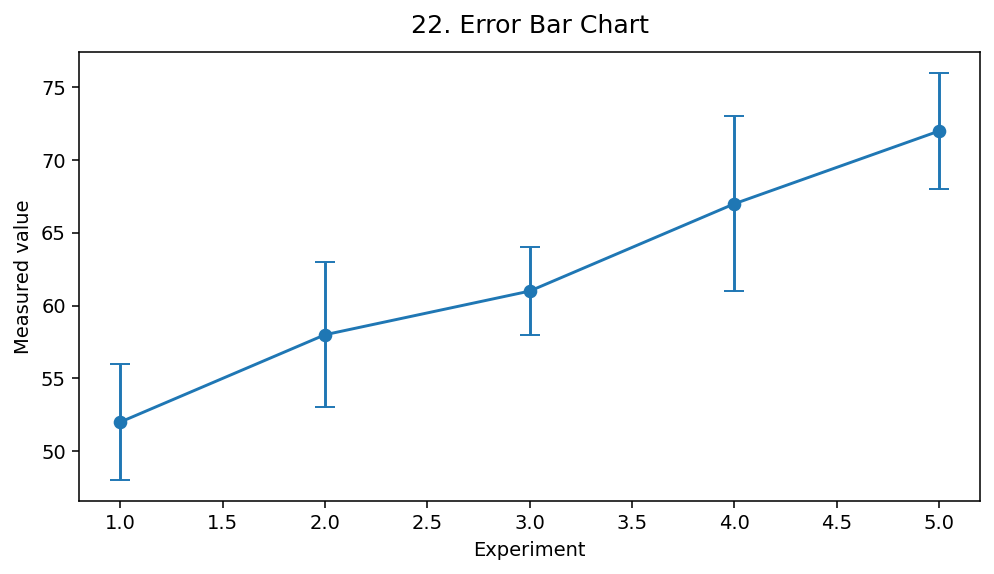

- Matplotlib: `plt.errorbar()`
- Seaborn: `sns pointplot() / custom`

## Quick function reference

| Chart | Matplotlib | Seaborn |
|---|---|---|
| Bar Chart | `plt.bar()` | `sns.barplot()` |
| Horizontal Bar Chart | `plt.barh()` | `sns.barplot()` |
| Grouped Bar Chart | `plt.bar()` | `sns.barplot()` |
| Stacked Bar Chart | `plt.bar()` | `Custom plotting` |
| Line Chart | `plt.plot()` | `sns.lineplot()` |
| Area Chart | `plt.fill_between()` | `Custom plotting` |
| Stacked Area Chart | `plt.stackplot()` | `Custom plotting` |
| Histogram | `plt.hist()` | `sns.histplot()` |
| Box Plot | `plt.boxplot()` | `sns.boxplot()` |
| Violin Plot | `plt.violinplot()` | `sns.violinplot()` |
| KDE Plot | `Density plotting` | `sns.kdeplot()` |
| Scatter Plot | `plt.scatter()` | `sns.scatterplot()` |
| Bubble Chart | `plt.scatter(s=...)` | `sns.scatterplot(size=...)` |
| Heatmap | `plt.imshow()` | `sns.heatmap()` |
| Pair Plot | `No single built-in function` | `sns.pairplot()` |
| Pie Chart | `plt.pie()` | `No standard direct function` |
| Donut Chart | `plt.pie(wedgeprops=...)` | `Custom plotting` |
| Treemap | `No standard built-in function` | `No standard built-in function` |
| Waterfall Chart | `Custom bar plotting` | `Custom plotting` |
| Funnel Chart | `Custom bar plotting` | `Custom plotting` |
| Radar Chart | `Polar axes` | `Custom plotting` |
| Error Bar Chart | `plt.errorbar()` | `sns pointplot() / custom` |

## Recommended six-class learning sequence

| Class | Topics |
|---|---|
| 1 | Line, bar, horizontal bar, grouped bar, stacked bar |
| 2 | Histogram, box plot, violin plot, KDE |
| 3 | Scatter plot, bubble chart, pair plot |
| 4 | Pie, donut, stacked bar, area and stacked area |
| 5 | Heatmap, correlation matrix, treemap |
| 6 | Waterfall, funnel, radar, error bars, chart selection and interpretation |

## How to choose the right chart

1. Comparing categories? Start with a bar chart.
2. Showing change over time? Use a line chart.
3. Studying the spread of a numeric column? Use a histogram or box plot.
4. Checking the relationship between two numeric columns? Use a scatter plot.
5. Checking correlations among many numeric columns? Use a heatmap.
6. Showing parts of a whole? Consider a stacked bar, pie, donut, or treemap.
7. Showing uncertainty? Use error bars or a box plot, depending on the data.

## Charts to prioritize for Data Analyst roles

- **Bar chart:** category comparisons and ranking.
- **Line chart:** time-based trends.
- **Histogram:** distribution and skewness.
- **Box plot:** spread and outlier detection.
- **Scatter plot:** relationships and possible correlation.
- **Heatmap:** correlation analysis.

A good analyst does more than create a chart. They explain what it shows, identify meaningful patterns, mention limitations, and connect the finding to a business question.

## Important notes

- Choose a chart based on the analytical question, not appearance.
- Avoid excessive decoration when a simple chart communicates better.
- Pie and donut charts become difficult to read with many categories.
- Correlation does not prove causation.
- Box-plot points beyond whiskers are potential outliers, not necessarily errors.
- The example images are illustrative; values are synthetic.
